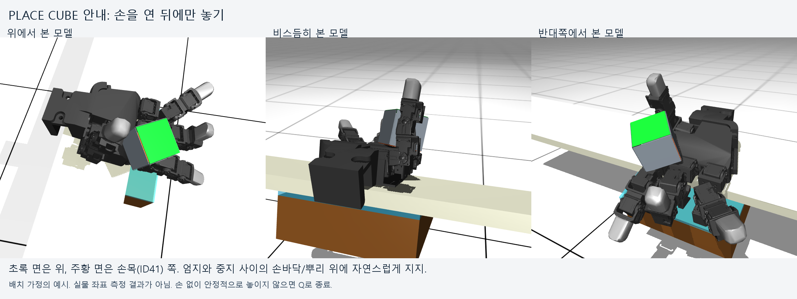

# 새 준비 자세에서 큐브 잡기

빈손 준비 자세 이동은 완료됐다. 이번에는 실제 큐브를 같은 끝 자세로 잡았다가 자동으로 손을 열어 주는 동작만 확인한다. 수평 90도 회전은 다음 단계다.

1. 큐브를 손과 카메라 밖에 둔다. 손가락과 받침은 지금 상태로 둔다.
2. 안내받은 `leap_new_pair_grasp.cmd`를 실행하고 터미널에서 첫 SPACE를 누른다. 현재 꺼진 모터의 각도를 읽고 복귀 경로를 검사한다.
3. `PLACE CUBE NOW`가 나온 뒤에만 큐브를 손바닥과 손가락 뿌리 위, 엄지와 중지 사이에 놓는다. 초록 면은 위, 주황 면은 손목 ID41 쪽이다. 약간 기울어지는 것은 가능하지만 손으로 받쳐야만 머무른다면 Q로 끝낸다. 억지로 끼우지 않는다.
4. 사람 손을 빼고 두 번째 SPACE를 누른다. 천천히 잡고 3초 관찰한 뒤 자동으로 손을 연다. 자동 열기가 끝날 때까지 큐브를 당기지 않는다.
5. `OPEN complete. REMOVE CUBE` 뒤 큐브를 빼고 세 번째 SPACE를 누른다. 토크 OFF와 설정 복구를 확인하고 종료한다.
6. 완료 후 채팅에는 `했어`만 보내면 된다. 로그와 영상은 새 `new_pair_grasp_...` 폴더에 저장된다.

그림은 배치 가정을 표현한 모델이다. 실물 좌표 등록 결과나 실물 파지 성공 사진이 아니다. 큐브 색은 안내 그림에서만 표시했으며 제어용 모델은 바꾸지 않았다.

이번 파일은 첫 SPACE 전에만 큐브가 없는지 확인한다. 놓은 뒤에는 ID40이 가려져도 진행할 수 있다. 중단 기준과 목표 2틱 상한, 450mA와 PID는 유지했다. 실시간 SAC 또는 카메라 피드백 제어는 실행하지 않는다.
