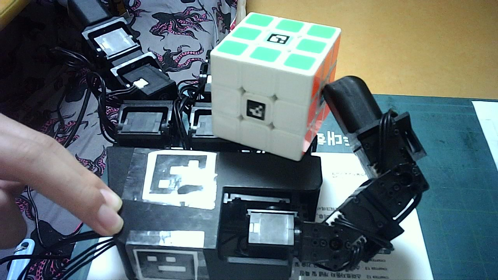

# 오른손 큐브 조작 진행 보고

**2026-11-13 미팅용 · 자료 기준 2026-11-13 시작 검사 수정 반영**

## 목표와 접근

오른손으로 큐브 전체 방향을 바꾸고 아래쪽을 잡아, 왼손이 윗층을 돌릴 작업 공간을 확보하는 것이 목표입니다.
동작 연결 목표는 **전체 회전 → 파지 유지 → 다음 회전 → 파지 유지**입니다.
팀 원본 `right_rl_with_mujoco`를 바탕으로 실제 모터 대응, 관측·추종 감시, 접촉 모델과 파지 전환 경로를 수정·확장했습니다.

## 진행한 내용과 확보한 자료

| 항목 | 확보한 내용 |
|---|---|
| 실물 제어 | 16개 모터 대응·각도 변환, 450mA/2틱/75ms 실행, 통신·전압·전류·추종 감시 및 종료 처리 |
| 실물 기록 | 회전·전환 단계의 영상, 관절·전류 기록, 중지와 약지 기준 자세 및 비교 사진 |
| 정책 작업 | 기존108차원 정책과 로컬110차원 보정 정책의 출처·관측 차이 정리, SAC 추가 학습·평가 및 NumPy 추론 비교 기록 |
| 전환 경로 | 중지 윗마디 후퇴 → 엄지 이송 → 뒤쪽 접촉 → 엄지·중지 끝마디 → 다음 마디 → 관찰 유지 경로 준비 |
| 오프라인 검토 | 새 관측 경로의 적재 모델6조건·빈손3조건·소프트웨어9시험 기록, 원본170개 결합 해시 확인 |
| 팀 전달 | `feature/hardware`에 코드·모델·학습·실험 자료 패키지22,022개 파일 업로드 및 원격 커밋 확인 |

*실물 실험 중 저장한 화면. 프레임별 단계 해석과 관절 기록을 함께 보존했습니다.*

## 내일 결합 작업에서 맞출 내용

- 공통 바닥 기준 큐브 중심·윗층 접촉 높이, 양손 방향과 받침 위치.
- 오른손 방향 변경/지지 → 왼손 윗단 파지/회전/해제의 요청·완료·취소 규약.
- 오른손 도달 응답 후에도 지지 제어와 상태 감시를 이어가는 제어 수명.
- 왼손이 받을 수 있는 큐브 위치·각도 오차와 공통 파지 영역.

**공유 위치:** `right_rl_with_mujoco` → `feature/hardware` → `hardware/right_hand/`.
기준 커밋 `76a2438`. 상세 인계는 같은 보충 폴더의 `START_HERE.md`에 정리했습니다.

<!-- PAGEBREAK -->

## 마지막: 남은 문제와 다음 실험

**1. 최근에는 시작 전 검사에서 멈췄습니다.**
11/12 17:33·17:37·17:39의 세 시도는 모두 빈손 시작 자세 검사에서 종료됐으며 모터 구동 지령은 0회였습니다.
검사 모델에서 엄지 끝과 검지 뿌리 쪽 겹침 약0.936mm가 검출됐습니다.
저장 경로 재검토에서는 시작 겹침이 초기값보다 커지지 않고 손을 펴는 과정에서 사라지는 것을 확인했습니다.
사용자가 이 초기 겹침을 허용하도록 요청했으며, 2026-11-13 해당 쌍과 빈손 구간으로 한정해 반영했고, 저장 자세3개의 정적201/동적9조건씩을 통과했습니다. 초기값보다 깊어지지 않고 OPEN 48목표 이내에 사라지는 조건이며, 새 실물 관측이 다음 작업입니다.
실제 부품 간섭을 mm 단위로 측정한 결과는 아닙니다.

**2. 회전 뒤 최종 작업 파지와 다음 회전 연결이 남아 있습니다.**
앞선 16:28 실물 전환은 약지 ID15 추종오차0.183rad에서 종료됐습니다.
후속 후보에는 엄지 접촉을 주황 옆면 뒤쪽으로 옮기고 끝마디부터 굽히는 순서를 반영했습니다.
현재 파일은 이 이동을 관찰하는 범위이며 최종 세 손가락 파지·윗단 공간·다음 회전의 실물 검증이 필요합니다.

**3. 학습·모델 결과를 실물 성능으로 확장하는 검증이 남아 있습니다.**
저장 기록에는 11/9~10의 SAC 추가 학습 요청 분량 합계90,000환경 스텝과 별도 모방학습15,000갱신이 있습니다.
다만 접촉 계산10회 모델의 좋은 결과가 50/100회 조건에서 재현되지 않은 기록도 있어 채택 조건을 구분하고 있습니다.
현재 실물은 검토한 경로 재생이며, 새 증류 정책과 실물 SAC 폐루프 적용은 완료 상태가 아닙니다.

**4. 양손 결합의 최종 조건을 확인해야 합니다.**
공통 좌표, 왼손의 허용 오차·실제 회전 하중, 양손 간섭과 미들웨어의 실제 모터 연결을 확인해야 합니다.
미들웨어 검토는 11/9 저장 커밋 기준이므로 이후 팀 수정분을 함께 비교합니다.

**다음 순서:** 수정된 시작 검사로 실물 재개 → 끝마디 우선 이동 관측 → 세 손가락 파지 유지 → 다음 회전 연결 → 양손 하중·간섭 검증.

### 짧게 설명할 때

“지금까지 실제 손의 모터 대응과 실행·감시 체계를 정리하고, 회전 후 큐브를 다시 잡는 경로와 실험 기록을 확보했습니다.
기존 정책과 SAC 보정 학습도 비교했으며 자료는 팀 브랜치에 공유했습니다.
최근 세 번은 동작 도중이 아니라 시작 자세의 모델 검사에서 막혔습니다.
초기 겹침을 제한적으로 처리하는 수정과 모델 재검증을 마쳤으며, 이제 밀기 동작을 실물에서 확인하고, 최종 파지에서 다음 회전까지 연결하는 것이 다음 단계입니다.”

### 근거 자료

- `right_hand_rotation_20261112/tip_first_trial_v2/READY.json`, `review.json`
- `lower_grip_trial_20261112_162806_610535/result.json`, `right_hand_rotation_20261112/lower_grip_actual_review/`
- 이 보충 폴더의 `evidence/start_review.json`, `evidence/empty_path_trace.json`
- `right_hand_rotation_20261109/policy_audit/STATUS.md`, `prehardware_policy_cycle/next_cycle/STATUS.md`
- `team_integration_20261109/middleware_review/REVIEW.md`
